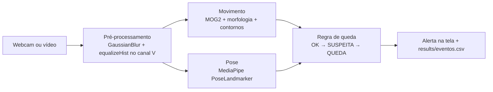

# Guardião de Quedas

Detecção de queda de idosos pela webcam, com alerta em tempo real.
Global Solution 2026.2 (CitizenTech) · Cognitive Computing, Computer Vision and IoT Systems · Prof. Arnaldo Jr.

## Integrantes

| Nome | RM |
|---|---|
| Pedro Lima | 553664 |
| Murilo Fernandes | 553582 |
| Bruno Furlan | 553604 |
| Thais Lopes | 553620 |

## Problema

Quedas são um dos principais riscos para idosos que moram sozinhos, e o tempo até alguém perceber a queda agrava as consequências. O Guardião de Quedas usa uma câmera comum para detectar quando a pessoa cai e permanece no chão, e emite um alerta. Tudo roda no próprio computador: nenhuma imagem é enviada para fora.

Conexão com a GS: tecnologia de apoio a idosos para ampliar autonomia e segurança (ODS 3, 10 e 11).

## Como funciona



A cada quadro o sistema mede:

- **ângulo do tronco** em relação à vertical (0° em pé, 90° deitado), a partir de ombros e quadris;
- **altura do quadril** na imagem;
- **fração de pixels em movimento** (máscara do MOG2).

Regra de decisão:

1. **SUSPEITA**: o quadril desce 15% ou mais da altura da imagem em até 1 s, com movimento na cena.
2. **QUEDA**: durante a suspeita, o tronco fica com 55° ou mais por 1 s seguido.
3. Se em 3 s o tronco não deitar, a suspeita é descartada (ex.: a pessoa só sentou).
4. O alerta termina quando o tronco volta a menos de 40° por 1 s.

Sentar rápido, agachar, abaixar para pegar algo e deitar devagar não disparam alerta, porque falta uma das duas condições.

## Técnicas utilizadas

| Técnica | Onde |
|---|---|
| Leitura e exibição de vídeo com OpenCV | `src/app.py` |
| Equalização de histograma | `src/preprocessamento.py` |
| Filtro gaussiano e limiarização | `src/preprocessamento.py`, `src/movimento.py` |
| Espaço de cor HSV e contornos | `src/preprocessamento.py`, `src/movimento.py` |
| Morfologia (abertura e fechamento) | `src/movimento.py` |
| Subtração de fundo MOG2 e bounding box | `src/movimento.py` |
| MediaPipe PoseLandmarker (Tasks API, modo VIDEO) | `src/pose.py` |

## Instalação

Requer Python 3.10 ou superior.

```bash
python -m venv .venv
.venv\Scripts\activate        # Windows
# source .venv/bin/activate   # Linux/macOS
pip install -r requirements.txt
```

O modelo de pose (`pose_landmarker_lite.task`) é baixado sozinho para `models/` na primeira execução.

## Execução

Todos os comandos são executados na raiz do repositório.

```bash
# Tempo real pela webcam (Esc para sair)
python -m src.app

# Outra câmera, modelo mais preciso, janela com a máscara de movimento
python -m src.app --fonte 1 --modelo heavy --mascara

# Rodar em um vídeo gravado
python -m src.app --fonte data/clips/queda/queda_lado_01.mp4

# Testes da regra de decisão, das métricas e do movimento
python -m pytest -q
```

Dica para a demonstração: câmera **de lado** para a área, pessoa de corpo inteiro no quadro, a uns 3 m.

## Avaliação

1. Grave clipes curtos (5 a 10 s) e coloque em:
   - `data/clips/queda/`: quedas simuladas (de lado, para frente, para trás);
   - `data/clips/nao_queda/`: sentar rápido, agachar, pegar objeto no chão, deitar devagar, andar.
2. Rode a avaliação e gere o relatório:

```bash
python -m src.avaliar
python -m src.gerar_relatorio
```

Saídas em `results/`:

- `resultados.csv`: resultado por clipe, com e sem pré-processamento;
- `metricas.json`: matriz de confusão, acurácia, precisão, recall, F1, especificidade, FPS e taxa de pose;
- `matriz_confusao_*.png`, `comparacao_metricas.png`;
- `curvas/`: ângulo do tronco e altura do quadril ao longo do tempo, por clipe.

O notebook `notebooks/analise_resultados.ipynb` mostra as tabelas e os gráficos.

## Resultados

> Preencher depois de rodar `python -m src.avaliar` com os clipes da equipe: copie a tabela de `results/metricas.json` e insira as figuras de `results/`.

## Estrutura

```
src/
  preprocessamento.py   filtro e equalização
  movimento.py          MOG2, morfologia, contornos
  pose.py               MediaPipe PoseLandmarker
  regras_queda.py       máquina de estados da queda
  pipeline.py           junta as etapas e desenha o resultado
  app.py                aplicação em tempo real
  avaliar.py            métricas e gráficos nos clipes
  metricas.py           matriz de confusão e métricas
  gerar_relatorio.py    gera docs/relatorio.pdf
tests/                  testes automatizados
notebooks/              análise dos resultados
docs/relatorio.pdf      relatório (contexto, métodos, análises, considerações finais)
data/clips/             clipes de avaliação
results/                saídas da avaliação e log de eventos
```

## Limitações

- Quedas na direção da câmera alteram pouco o ângulo do tronco em 2D.
- A medida de descida depende da distância da pessoa à câmera.
- Uma pessoa por vez, com ombros e quadris visíveis.
- As quedas de teste são simuladas e o conjunto é pequeno.
