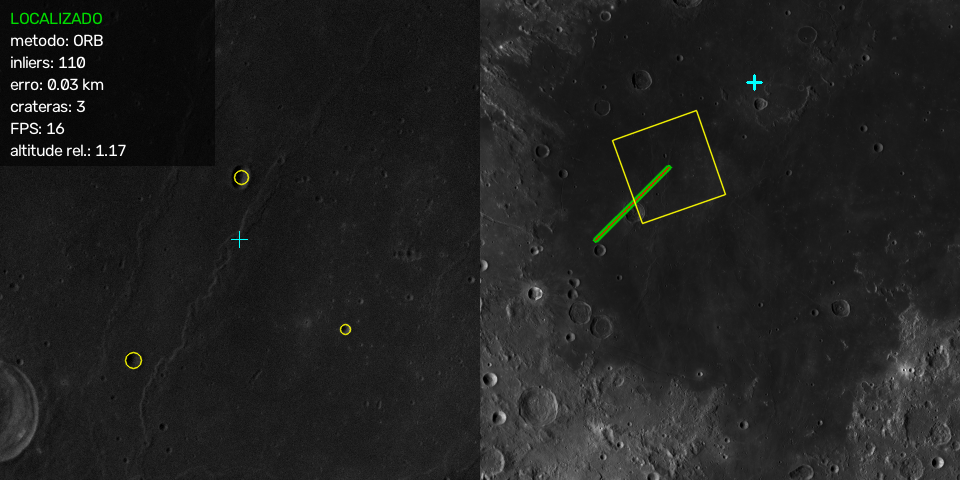

# Navegação de pouso lunar por visão computacional

**Global Solution 2026/2 - FIAP · Cognitive Computing, Computer Vision and IoT Systems**\
Tema da GS: *Space Connect - tecnologia espacial aplicada a desafios reais*

Uma sonda descendo na Lua não tem GPS. Para pousar com precisão, ela precisa saber onde está usando a própria câmera. Essa técnica é chamada de *Terrain Relative Navigation* e foi usada, por exemplo, no pouso do Perseverance em Marte. Este projeto implementa uma versão simplificada com **processamento de imagem clássico** (OpenCV, sem redes neurais) e **dados reais da NASA/USGS**:

1. **Detecção de crateras** na imagem da câmera.
2. **Localização da sonda**: posição (lat/lon/km) e rumo sobre um mapa de referência.

As duas etapas são **medidas contra gabaritos públicos**: o catálogo de crateras de Robbins e a posição conhecida dos frames simulados.



## Resultados principais

**Detecção de crateras** (metade de teste do mapa, 562 crateras de 2 a 24 km do catálogo de Robbins):

| Método | Precisão | Recall | F1 |
|---|---|---|---|
| **Sombra-brilho** (escolhido) | **0,607** | **0,388** | **0,473** |
| HoughCircles (melhor configuração) | 0,089 | 0,203 | 0,124 |

**Localização** (300 imagens simuladas com rotação, zoom e degradações aleatórias; sucesso = erro < 1 km):

| Método | Sucesso | Erro mediano | Tempo/imagem |
|---|---|---|---|
| **SIFT + homografia** | **75,3%** | **0,11 km** | 1205 ms |
| **ORB + homografia** (usado na demo) | 74,7% | 0,18 km | 168 ms |
| ORB sem equalização de histograma | 38,3% | 0,16 km | 35 ms |
| Template matching (baseline) | 1,3% | 24,7 km | 189 ms |

O erro mediano é calculado só sobre as imagens que o método conseguiu localizar. O do template, que localiza pouquíssimas, não é comparável.

Os detalhes e a discussão estão em [docs/relatorio.pdf](docs/relatorio.pdf) e nos notebooks.

## Como executar

Requisitos: Python 3.11+ (testado no 3.14) e cerca de 120 MB de disco para os dados.

```bash
python -m venv .venv
.venv\Scripts\activate          # Windows  (Linux/macOS: source .venv/bin/activate)
pip install -r requirements.txt
```

### 1. Baixar os dados (uma vez, de 5 a 10 minutos)

```bash
python baixar_dados.py
```

O script baixa para `dados/`, que não é versionada:

| Arquivo | Conteúdo |
|---|---|
| `mapa_regiao.png` | Recorte de 6066 × 6066 px (100 m/px) do mosaico global **LROC WAC** (NASA/LRO), na região de lat −5° a 15° e lon 15° a 35° (borda de Mare Tranquillitatis). O arquivo global tem 5,96 GB, mas o script lê só as linhas e colunas da região, com requisições HTTP *Range* (~37 MB). |
| `crateras_regiao.csv` | Crateras do **catálogo de Robbins (2018)** na região (lat, lon, diâmetro em km). |

### 2. Demo da descida

```bash
python main.py              # localização por ORB
python main.py --metodo sift
```

A janela mostra dois painéis:
- **à esquerda**, a câmera da sonda, com as crateras detectadas em amarelo;
- **à direita**, o minimapa, com a trajetória real (verde), a estimada (vermelho), a área vista pela câmera e o alvo de pouso (ciano).

| Tecla / mouse | Ação |
|---|---|
| clique no minimapa | escolhe um novo ponto de pouso |
| `espaço` | pausa / continua |
| `d` | liga / desliga a detecção de crateras |
| `m` | alterna ORB ↔ SIFT |
| `s` | salva um print em `resultados/demo.png` |
| `q` / `Esc` | sai |

### 3. Notebooks (análises e métricas)

```bash
jupyter notebook notebooks/
```

| Notebook | O que mostra |
|---|---|
| `01_dados.ipynb` | O mapa, a divisão ajuste/teste, a distribuição de tamanhos, a direção do sol e o gabarito sobre a imagem |
| `02_deteccao.ipynb` | Ablação **Hough × sombra-brilho**, escolha de parâmetros e métricas na metade de teste |
| `03_localizacao.ipynb` | **ORB × SIFT × template matching**, robustez a rotação, zoom, ruído e iluminação, e mar × terras altas |

As figuras e tabelas ficam salvas em `resultados/`.

## Como funciona

### Detecção de crateras: sombra-brilho

Com o sol baixo, uma cratera pequena aparece como **uma mancha escura** (a parede do lado do sol, em sombra) **colada a uma mancha clara** (a parede oposta, iluminada).

| Etapa | Técnica |
|---|---|
| Suavização | Blur gaussiano 3×3 |
| Sombra / brilho | Limiar **local**: o pixel fica 18 níveis abaixo (sombra) ou acima (brilho) da média de uma janela 21×21 |
| Limpeza | Abertura morfológica, com elemento elíptico 3×3 |
| Manchas | Componentes conectados e centroides (momentos) |
| Pareamento | Cada sombra se liga ao brilho mais próximo **na direção do sol** (±40°), que precisa estar próximo e ter área parecida |
| Cratera | Centro no meio do par, raio = 0,8 × a distância entre os centroides |

A direção do sol foi medida nos dados: em 97% das crateras do catálogo, a metade oeste é mais escura. O **HoughCircles** (com CLAHE) também foi implementado e comparado. Ele perde porque as crateras pequenas não formam um contorno circular fechado (notebook 02).

### Localização: features + homografia

| Etapa | Técnica |
|---|---|
| Normalização | Equalização de histograma do mapa e do frame |
| Pontos característicos | **ORB** (ou SIFT) |
| Casamento | `knnMatch` (k = 2) com **teste da razão de Lowe** (0,75) |
| Geometria | `findHomography` com **RANSAC** (5 px, no mínimo 15 inliers) |
| Posição e rumo | Centro do frame projetado pela homografia; ângulo da sua parte linear |
| Baseline | `matchTemplate` (`TM_CCOEFF_NORMED`) |
| Rastreamento | Depois da 1ª localização, busca só numa janela em volta da última posição |

### Câmera simulada

Não existem imagens públicas de descida sobre o mesmo mapa com a posição exata, então a câmera é **simulada**. Cada frame é um recorte do mapa com posição, rotação e zoom conhecidos, mais ruído, blur e mudanças de brilho e gama (`simulador.py`). A posição real conhecida é o gabarito da localização.

## Estrutura

```
baixar_dados.py        baixa o recorte do mosaico e o catálogo
main.py                demo da descida
pouso_lunar/
  config.py            todos os parâmetros, com a justificativa de cada valor
  geo.py               lat/lon → pixel (projeção equiretangular)
  dados.py             carrega o mapa e o gabarito, divide ajuste/teste
  detector.py          detectores sombra-brilho e Hough
  localizador.py       ORB/SIFT + homografia; template matching
  simulador.py         câmera da sonda e trajetória de descida
  metricas.py          casamento detecção × gabarito, P/R/F1, erro em km
  visual.py            desenho dos painéis e do minimapa
notebooks/             análises (01 dados, 02 detecção, 03 localização)
resultados/            figuras e CSVs de métricas gerados pelos notebooks
docs/relatorio.pdf     relatório da GS
```

## Créditos dos dados

- **LROC WAC Global Morphologic Mosaic 100 m** (NASA / LRO / Arizona State University), distribuído pela USGS Astrogeology.
- **Robbins, S. J. (2019)**. *A new global database of lunar impact craters > 1-2 km: 1. Crater locations and sizes, comparisons with published databases, and global analysis.* JGR Planets, 124. doi:10.1029/2018JE005592. Distribuído pela USGS Astrogeology.
