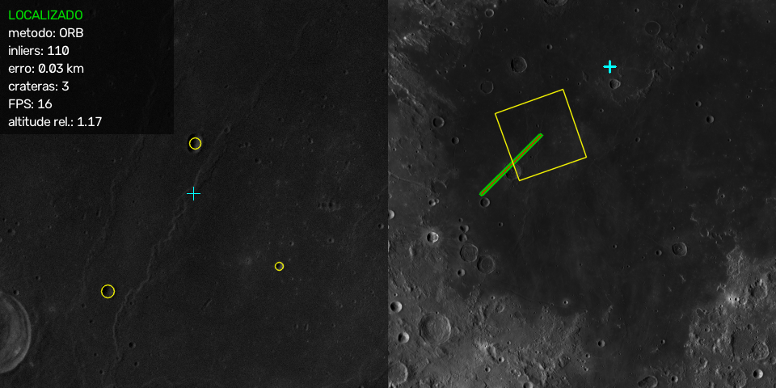

# Navegação de pouso lunar por visão computacional

**Global Solution 2026/2 - FIAP**\
**Tema:** Space Connect - tecnologia espacial aplicada a desafios reais\
**Repositório:** https://github.com/hPedro11/navegacao-pouso-lunar

---

## 1. Contexto e problema

Uma sonda que pousa na Lua não tem GPS, e o sinal até a Terra demora demais para que alguém a pilote em tempo real. Para pousar no lugar certo, ela precisa descobrir **sozinha, pela câmera, onde está**. Essa técnica, chamada *Terrain Relative Navigation*, foi usada no pouso do Perseverance em Marte e é uma das bases da nova corrida à Lua (ODS 9 - Indústria, inovação e infraestrutura).

O projeto resolve uma versão simplificada desse problema. A partir de uma imagem da câmera da sonda, o sistema:

1. **detecta as crateras**, que são os marcos naturais do terreno;
2. **estima a posição e o rumo** da sonda sobre um mapa da Lua.

Tudo foi feito com **processamento de imagem clássico** (OpenCV, sem redes neurais) e **dados reais**, e cada resultado é medido contra um gabarito público.

## 2. Dados

- **Mapa:** mosaico da Lua **LROC WAC** (NASA), a 100 m/px. Usamos uma região de **607 × 607 km** na borda do Mare Tranquillitatis, com mar liso e terras altas cheias de crateras. O arquivo original tem 6 GB, e o script `baixar_dados.py` baixa só os ~37 MB dessa região.
- **Gabarito das crateras:** catálogo de **Robbins (2018)**, da USGS, que traz posição e diâmetro de cada cratera. Avaliamos as **1301 crateras de 2 a 24 km** da região.
- **Câmera da sonda:** não existem imagens de descida com a posição exata conhecida, então a câmera é **simulada**. Cada imagem é um recorte do mapa com posição, rotação e altitude conhecidas, mais ruído, desfoque e mudanças de brilho.
- **Avaliação justa:** os parâmetros foram ajustados só na **metade oeste** do mapa, e os resultados abaixo vêm da **metade leste**, que não foi usada em nenhuma escolha.

## 3. Solução

### 3.1 Detecção de crateras: sombra-brilho

As imagens têm **sol baixo**, vindo do oeste, como medimos nos próprios dados. Nessas condições, uma cratera pequena aparece como **uma mancha escura (sombra) colada a uma mancha clara (parede iluminada)**. O detector procura exatamente esse par:

1. **Blur gaussiano** para tirar o ruído.
2. **Limiar local:** um pixel bem mais escuro que a vizinhança é sombra, e um bem mais claro é brilho.
3. **Abertura morfológica** para limpar pontos soltos.
4. **Componentes conectados e centroides** para encontrar as manchas.
5. **Pareamento:** cada sombra se liga à mancha clara mais próxima na direção do sol. O centro do par é a cratera, e a distância entre as manchas dá o raio.

Também testamos o **HoughCircles**, o detector de círculos clássico. Ele foi mal: as crateras pequenas não formam um círculo completo na imagem, e a textura do terreno gera muitos círculos falsos.

### 3.2 Localização da sonda: pontos característicos + homografia

1. **Equalização de histograma** do mapa e da imagem da câmera, para colocar os dois na mesma escala de brilho.
2. **ORB** encontra pontos característicos nas duas imagens. O **SIFT** foi testado como alternativa.
3. **Casamento** dos pontos com o **teste da razão de Lowe**, que descarta pares ambíguos.
4. **Homografia com RANSAC**, que ignora os casamentos errados e calcula como a imagem da câmera se encaixa no mapa.
5. O centro da imagem projetado no mapa dá a **posição**, e a rotação da homografia dá o **rumo**.

Como comparação usamos o **template matching**, que procura a imagem inteira no mapa.

### 3.3 Demo

`python main.py` mostra uma descida simulada:
- **à esquerda**, a câmera, com as crateras detectadas;
- **à direita**, o minimapa, com a trajetória real (verde) e a estimada (vermelho).

Um clique no minimapa escolhe um novo ponto de pouso.

## 4. Resultados

**Crateras.** Comparamos as crateras que o programa encontrou com o catálogo de crateras da USGS. O detector de sombra e brilho acertou cerca de **4 em cada 10 crateras** do catálogo, e quase **2 em cada 3 marcações** que ele fez eram crateras de verdade. O HoughCircles foi bem pior: a maioria dos círculos que ele marcou não era cratera.

**Localização da sonda.** Testamos 300 imagens da câmera, com a sonda em posições, alturas e ângulos diferentes. O programa encontrou a posição certa em **3 de cada 4 imagens**, com erro de uns **200 metros**. O template matching só funcionou quando a imagem não estava girada.

## 5. O que aprendemos

- **Testar antes de escolher.** O HoughCircles parecia a escolha óbvia, mas não funcionou bem com o sol baixo. Olhando as imagens, percebemos o padrão de sombra e brilho e mudamos o método.
- **A equalização de histograma fez muita diferença.** O mapa da Lua é escuro, e sem equalizar o programa errava muito mais a posição da sonda.
- **ORB funciona mesmo com a imagem girada**, coisa que o template matching não faz.

## 6. Limitações

- **As imagens da câmera são simuladas** a partir do próprio mapa. Uma descida de verdade teria outra iluminação e outro ângulo de visão.
- **Imagens com muito ruído** atrapalham a localização.
- O **mar**, liso e com poucos detalhes, é mais difícil de localizar que as **terras altas**.

## 7. Conclusão

Usando técnicas de processamento de imagem e dados reais da NASA/USGS, o programa consegue encontrar crateras e descobrir onde a sonda está na maioria das imagens, mesmo com a câmera girada. É uma versão simples da tecnologia que ajuda sondas a pousar sozinhas na Lua.

## Referências

- Robbins, S. J. (2019). *A new global database of lunar impact craters > 1-2 km.* JGR Planets, 124. doi:10.1029/2018JE005592.
- NASA / LRO / LROC (ASU). *LROC WAC Global Morphologic Mosaic 100 m.* USGS Astrogeology.
- Rublee, E. et al. (2011). *ORB: an efficient alternative to SIFT or SURF.* ICCV.
- Lowe, D. G. (2004). *Distinctive image features from scale-invariant keypoints.* IJCV.
- Fischler, M. A.; Bolles, R. C. (1981). *Random sample consensus.* Communications of the ACM.
